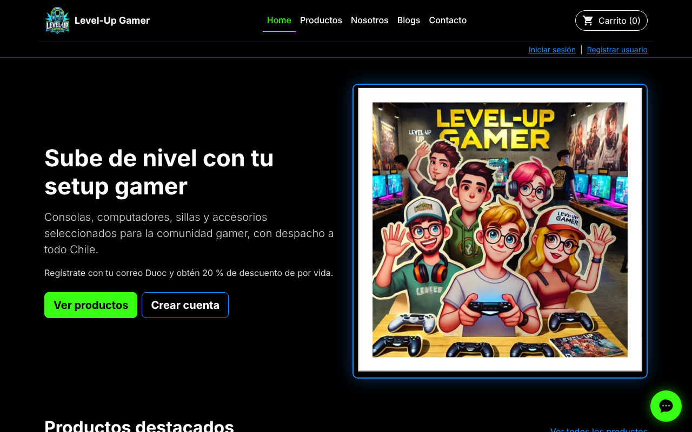
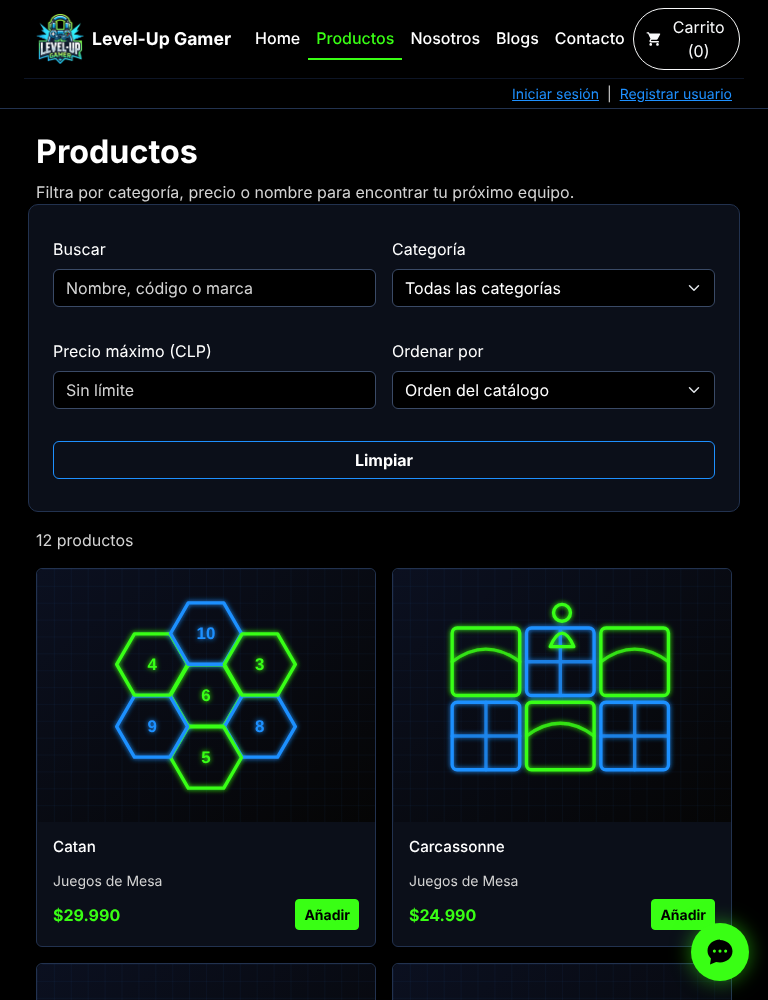
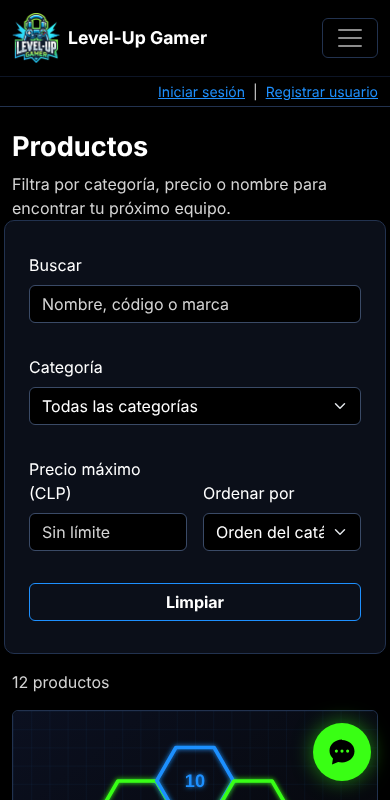

# 🎮 Level-Up Gamer (React)

Tienda online gamer — migración del Parcial 1 (HTML/CSS/JS) a **React + Bootstrap**, con pruebas unitarias en **Jasmine + Karma**.
Asignatura **DSY1104 – Desarrollo Fullstack II** (DUOC UC), Evaluación Parcial N° 2.

## Características

- Catálogo de 12 productos en 10 categorías, con filtros (categoría, texto, precio máximo, orden) y alertas de stock crítico/agotado.
- Carrito persistente, cupones `LEVELUP10` (10 %) y `GAMER5000` ($5.000 desde $50.000), descuento Duoc 20 % de por vida (no acumulable: se aplica el mayor) y pago simulado con órdenes `LUG-000N`.
- Historial "Mis pedidos" para cada usuario con sesión (`/mis-pedidos`): sus órdenes con fecha, total, estado y detalle. La barra de sesión muestra al cliente su nivel, puntos y código de referido.
- Registro con validación (RUN módulo 11, mayor de 18, correos permitidos con sugerencia, región/comuna dependientes), referidos (+100 puntos) y niveles Novato/Jugador/Veterano/Leyenda.
- Login con roles **Administrador / Vendedor / Cliente** y rutas protegidas.
- Panel de administración: dashboard, productos (CRUD con imagen ≤ 300 KB), usuarios (solo administrador) y órdenes.
- Contacto, boletín, blogs, Nosotros con video, botón de WhatsApp.
- Diseño responsivo con Bootstrap (tema oscuro) y accesibilidad (etiquetas, `aria-*`, foco al primer error).

## Cuentas de demostración

| Rol           | Correo            | Contraseña |
| ------------- | ----------------- | ---------- |
| Administrador | admin@duoc.cl     | admin123   |
| Vendedor      | vendedor@duoc.cl  | vend123    |
| Cliente       | cliente@gmail.com | cliente1   |
| Cliente Duoc  | alumno@duoc.cl    | duoc1234   |

> Sin backend, los datos viven en `localStorage` y las contraseñas se guardan en texto plano (limitación asumida; con servidor se usaría hash).

## Tecnologías

React 18 · React Router 6 (HashRouter) · Bootstrap 5.3 · Vite 5 · Jasmine 5 · Karma 6 · Istanbul (karma-coverage) · React Testing Library.

## Instalación y uso

Requisitos: Node.js 18+ y Google Chrome/Chromium (para Karma).

```bash
npm install
npm run dev        # http://localhost:5173
npm run build      # producción en dist/
npm run preview
```

## Pruebas y cobertura

```bash
npm test
npm run test:watch
```

- Resultado: `Executed 254 of 254 SUCCESS`.
- Cobertura: **99,48 %** sentencias · **95,28 %** ramas · **99,36 %** funciones · **99,5 %** líneas (`coverage/index.html`).
- Si Chrome está en otra ruta: `CHROME_BIN` (Windows: `set CHROME_BIN=C:\Program Files\Google\Chrome\Application\chrome.exe`).
- Mocks: `spyOn(Storage.prototype, …)`, `spyOn(Math, 'random')`, `jasmine.createSpy`, `jasmine.clock()`, `MemoryRouter`.

## Estructura

```
src/
├─ data/        productos, regiones, blogs
├─ lib/         lógica pura (storage, format, validators, auth, store, cart)
├─ context/     Auth, Cart, Toast
├─ hooks/       useFormValidation
├─ components/  piezas reutilizables
├─ pages/       tienda y pages/admin
├─ styles/      custom.css
└─ **/*.spec    pruebas
karma.conf.cjs  configuración de Karma
docs/           ERS, cobertura, guion y capturas
```

## Capturas

| Escritorio                                | Tablet                                                  | Móvil                                                 |
| ----------------------------------------- | ------------------------------------------------------- | ----------------------------------------------------- |
|  |  |  |

## Documentación

- `docs/ERS_Level-Up-Gamer_v2.docx`
- `docs/Documento_Cobertura_Testing_Level-Up-Gamer.docx`
- `docs/Guion_Presentacion_Level-Up-Gamer.docx`
